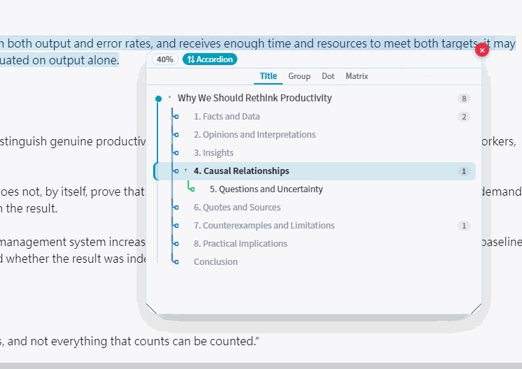
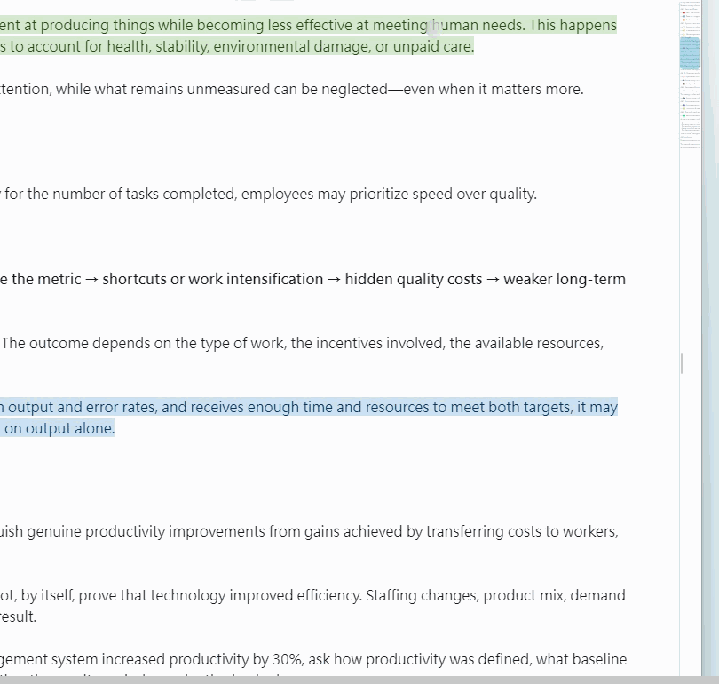
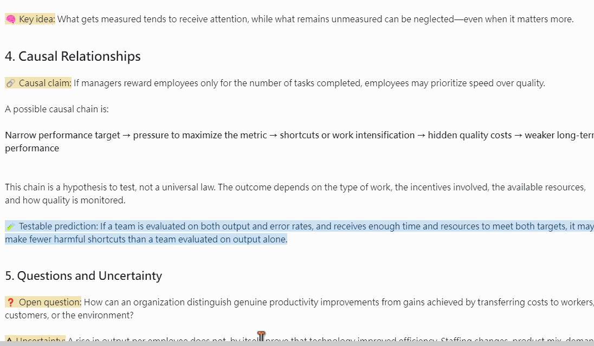
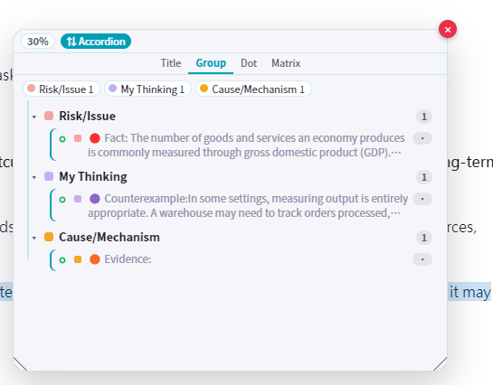
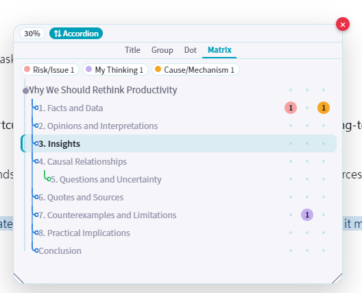
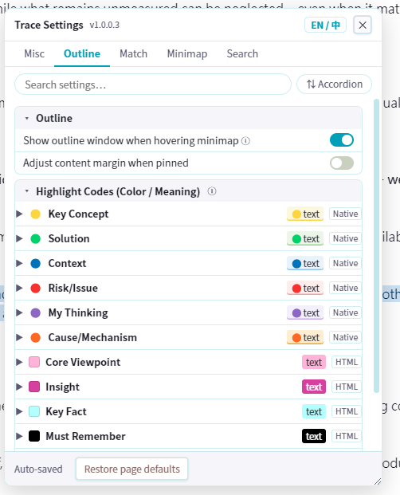
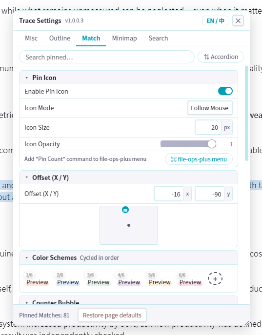

# Trace

> Outline navigation, minimap hover, match highlighting, and vault-wide search for Obsidian.

大纲导航 · Minimap 悬停 · Match 匹配高亮 · 全库搜索。Trace 为长文档阅读提供可视化定位与知识标记能力。

> Outline navigation · Minimap hover · Match highlighting · Vault-wide search. Trace provides visual positioning and knowledge marking for long-document reading.

## 功能演示

> ## Demo

### Minimap × 大纲

悬停 minimap 自动展开大纲面板，文档滚动与大纲高亮实时联动。

> Hover the minimap to auto-expand the outline panel; document scroll and outline highlighting are synced in real time.

### 搜索

划词即搜，全库匹配结果以悬浮列表呈现，支持缓存与手动刷新。

> Select text to search the entire vault; results appear in a floating list with caching and manual refresh.

### Match 匹配高亮

选中文本全库匹配并高亮标注，Pin 图标标记关键位置。

> Selected text is matched and highlighted across the vault; pin icons mark key locations.

### 大纲视图

大纲面板支持 Title / Group / Dot / Matrix 四种视图切换。

> The outline panel supports four views: Title / Group / Dot / Matrix.

**Group 分组视图** — 按颜色分类分组浏览标记内容：

> **Group view** — Browse marked content grouped by color category:

**Matrix 矩阵视图** — 大纲结构与分类标记的交叉矩阵：

> **Matrix view** — Cross-matrix of outline structure and category markers:

## 核心功能

> ## Features

- **大纲** — 悬停 minimap 自动展开，Title / Group / Dot / Matrix 四种视图；文档滚动与大纲高亮双向联动

  > **Outline** — Auto-expand on minimap hover; four views (Title / Group / Dot / Matrix); bidirectional sync between document scroll and outline highlight.

- **Minimap** — 编辑器右侧缩略条，悬停触发大纲 / 搜索窗口，4 条独立可拖边界分区

  > **Minimap** — Thumbnail bar on the editor right edge; hover triggers outline / search windows; 4 independent draggable zone boundaries.

- **Match** — 划词全库匹配高亮，Pin 图标标记关键位置，多色分类标记（圆点 / 方块），计数气泡

  > **Match** — Selection triggers vault-wide match highlighting; pin icons mark key positions; multi-color category markers (dots / squares); counter bubble.

- **搜索** — 划词即后台全库搜索，内存 + 磁盘双层缓存，有缓存时悬停不自动重搜，手动刷新按钮

  > **Search** — Selection triggers background vault-wide search; two-tier memory + disk cache; hovering with cache won't re-search; manual refresh button.

## 设置

> ## Settings

**Outline** — 悬停触发开关、高亮颜色代码配置（10 种预设颜色标记）：

> **Outline** — Hover trigger toggle, highlight color code config (10 preset color markers):

**Match** — Pin 图标模式 / 大小 / 透明度 / 偏移、6 种循环配色方案、计数气泡：

> **Match** — Pin icon mode / size / opacity / offset, 6 cycling color schemes, counter bubble:

## 安装

> ## Installation

从 GitHub Release 下载 `main.js`、`manifest.json`、`styles.css`，放入 `.obsidian/plugins/trace/` 目录，然后在 Obsidian 设置中启用插件。

> Download `main.js`, `manifest.json`, `styles.css` from the GitHub Release, place them in `.obsidian/plugins/trace/`, then enable the plugin in Obsidian settings.

## 许可

MIT

> ## License
>
> MIT